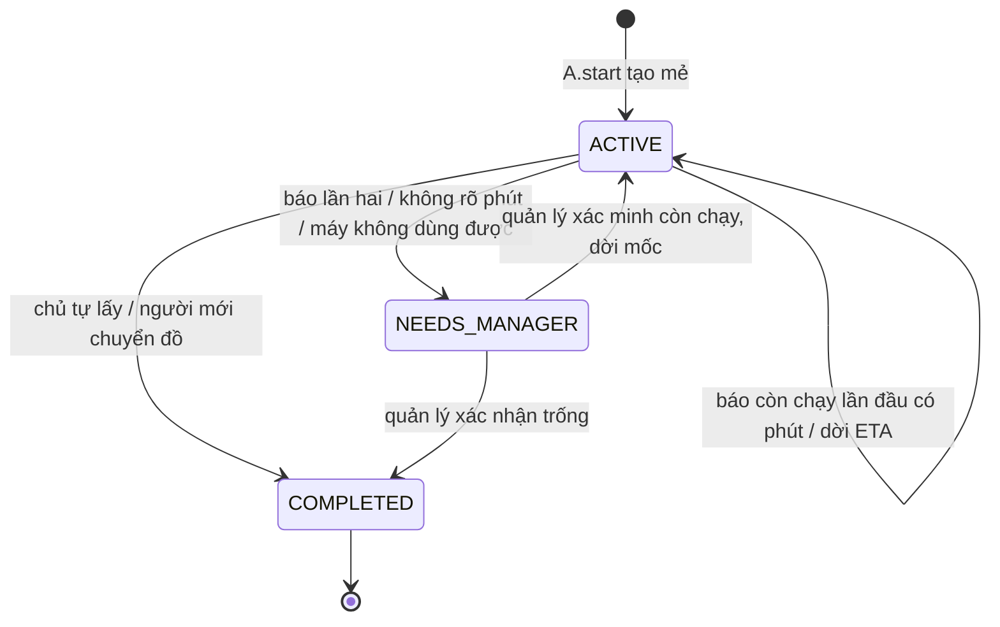

# Phần B — Mẻ giặt và bàn giao (tích hợp trực tiếp nhánh develop)

## Phạm vi và điểm nối với A/C

- **Không có API bắt đầu giặt mới**. `POST /api/buildings/{buildingId}/holds/{holdId}/start` thuộc `AllocationController` của A, B bổ sung body `{ "durationMinutes": 45, "handoverMode": "ALLOW_TRANSFER" }` hoặc `SELF_PICKUP` (1–360 phút). B gọi đúng `AllocationService.start` để tạo `WashCycle`, đổi `MachineHold: ACTIVE -> STARTED`, `QueueEntry: HELD -> WASHING`, `Machine: AVAILABLE -> RUNNING` trong **cùng @Transactional** dưới khóa hàng tòa.
- Trong lúc mẻ chưa bàn giao, QueueEntry vẫn **active/WASHING**; API `queue/me` tiếp tục trả **NONE, WAITING, HELD, WASHING** cho trạng thái yêu cầu cá nhân. Bổ sung `COMPLETED` vào lịch sử QueueEntry (active=false), không đưa ra thành trạng thái thứ năm của `queue/me`.
- C sử dụng `LaundryApp`, `MachineHoldCard`, `QueuePanel` cũ, B thêm `WashHoldActions`, `WashCycleCard`, `WashManagerPanel`. Cha vẫn poll chung 5 giây. GET lỗi/đang tải **không suy ra NONE**; form bắt đầu khóa khi không xác minh được mẻ trước.
- `HoldView` bổ sung `physicallyChecked: boolean` để A/C khôi phục nút xác nhận sau reload.

## API B (Spring Boot và Next.js cùng đường dẫn)

| Method | Path sau `/api/buildings/{buildingId}` | Quyền / nội dung |
| --- | --- | --- |
| POST | `/holds/{holdId}/start` | Chủ lượt, giữ ACTIVE và còn hạn, đã kiểm tra, máy trống; body `durationMinutes`, `handoverMode`. **Endpoint A duy nhất**. Gửi trùng cùng payload trả lại mẻ cũ. |
| GET | `/wash-cycles/me` | Thành viên duyệt, trả danh sách mẻ chưa hoàn tất của chính mình |
| GET | `/holds/{holdId}/handover` | Chính chủ lượt đang giữ, trả mẻ cũ chưa bàn giao hoặc null |
| POST | `/wash-cycles/{cycleId}/pickup` | Chủ mẻ xác nhận đã thấy máy dừng và lấy hết đồ; body `{ "physicallyConfirmed": true }` |
| POST | `/wash-cycles/{cycleId}/transfer` | Chủ lượt tiếp theo, nhận đúng máy sau mốc được kiểm tra; body `{ "holdId": "uuid", "physicallyConfirmed": true }` |
| POST | `/wash-cycles/{cycleId}/remaining` | Chủ mẻ báo số phút còn lại trước khi giao lượt kiểm tra (không âm thầm kéo dài hạn đã giao); `{ "remainingMinutes": 12 }` |
| POST | `/holds/{holdId}/report-running` | Người giữ lượt báo còn chạy; body `{ "remainingMinutes": 12 }` hoặc null (không rõ) |
| GET | `/wash-cycles/issues` | Chỉ quản lý; danh sách mẻ đang chờ quản lý |
| POST | `/wash-cycles/{cycleId}/resolve` | Chỉ quản lý; `{ "action": "CLEARED", "physicallyConfirmed": true }`, hoặc `DEFER` kèm `remainingMinutes`, hoặc `MAINTENANCE` |

Tất cả API mutation Java dùng HttpSession/CSRF, Next.js route dùng session bridge, xác thực người dùng từ Java `Authentication`. Lỗi 401/403/404/409/502 được giữ nguyên; xác nhận trống máy của quản lý không được bỏ qua mẻ cũ. Thao tác nghi kết quả do mất mạng: **tải lại trước khi gửi tiếp**.

### Mẫu mẻ giặt cho C

```json
{
  "id": "aaaaaaaa-aaaa-4aaa-8aaa-aaaaaaaaaaaa",
  "machineId": "bbbbbbbb-bbbb-4bbb-8bbb-bbbbbbbbbbbb",
  "queueEntryId": "cccccccc-cccc-4ccc-8ccc-cccccccccccc",
  "ownerName": "An",
  "startedAt": "2026-11-23T10:00:00Z",
  "durationMinutes": 45,
  "estimatedEndAt": "2026-11-23T10:45:00Z",
  "inspectionAt": "2026-11-23T10:55:00Z",
  "handoverMode": "SELF_PICKUP",
  "state": "ACTIVE",
  "overrunReports": 0,
  "phase": "SELF_PICKUP",
  "completedAt": null
}
```

Response thật có thêm `accountId`, `startHoldId`, `serverNow`, `completion`. UUID ví dụ không phải dữ liệu thật.

## Bốn luồng cần nghiệm thu

1. **Bắt đầu:** Người A được giữ 8 phút, xác nhận kiểm tra tại máy, nhập thời lượng/chế độ, A.start gọi tạo mẻ nguyên tử. Hai lần POST cùng payload không tạo hai mẻ; payload khác trả 409.
2. **Lấy sớm:** Chủ mẻ xác nhận máy dừng và lấy đồ, `WashCycle -> COMPLETED`, `QueueEntry -> COMPLETED (active=false)`, máy VERIFIED AVAILABLE rồi A cấp người đang sẵn sàng tiếp. Chủ mẻ thấy queue/me NONE.
3. **Chuyển đồ:** Đến ETA (ALLOW_TRANSFER) hoặc ETA+10 phút (SELF_PICKUP), job mời người sẵn sàng lên **kiểm tra**, máy có thể vẫn RUNNING và đồ cũ còn đó. Lượt mới HELD song song với mẻ cũ WASHING. Người mới xác nhận máy dừng và đã chuyển đồ, hoàn tất mẻ cũ; sau đó xác nhận kiểm tra của A và bắt đầu mẻ mới. Mọi bước kiểm tra đều là xác nhận **thực tế**, đồng hồ không tự xác minh máy dừng.
4. **Báo còn chạy:** Chủ lượt đang HELD báo phút còn lại, trong cùng giao dịch hủy hold/khôi phục vị trí hàng, dời ETA một lần (giữ nguyên thông tin mẻ cũ). Đến ETA mới chỉ giao lượt kiểm tra. Báo lần hai hoặc không rõ số phút -> NEEDS_MANAGER, chặn cấp máy; quản lý xác nhận xử lý, dời mốc hoặc bảo trì. Không có luồng xử lý chậu bị thiếu.

## Sơ đồ trạng thái mẻ



`phase` hiển thị từ Clock mà không tự mutate state: `RUNNING` -> `SELF_PICKUP` (chế độ tự lấy) -> `INSPECTION_ELIGIBLE`. Chỉ các xác nhận thực tế mới làm máy AVAILABLE/giải phóng yêu cầu cũ. Mỗi máy chỉ có một **WashCycle chưa hoàn tất**, dưới khóa tòa và không bắt đầu mẻ mới khi còn mẻ cũ.

## Chạy và test

Cần JDK 21, Maven 3.9+, Node 20.9+ và npm. Từ thư mục gốc chạy:

```powershell
mvn -f backend/pom.xml test
npm ci
npm run check
```

Để chạy thử web thật, mở 2 terminal:

```powershell
mvn -f backend/pom.xml spring-boot:run
```

```powershell
npm run dev
```

Mở `http://localhost:3000` (**không phải 8080**, 8080 chỉ backend). Khởi chạy bằng hai terminal như trên; script Windows trong ZIP không được đưa vào bản commit này. `WashFlowTest` dùng Clock điều khiển, không chờ 8/10/30 phút thật. Hãy thử với hai tài khoản cư dân đã được duyệt và một tài khoản quản lý.

## Nguồn mã và kết quả xác minh

Mã nghiệp vụ phần B được nhận từ gói `PHAN_B_da_sua_trung_key_React (1).zip` do Hải cung cấp. Thủy hỗ trợ tích hợp và chạy kiểm thử; Claude Code hỗ trợ sửa test phân quyền `/start` để gửi body hợp lệ, chuyển `Date.now()` khỏi render sang state/effect kèm kiểm tra hạn lúc bấm, dọn import thừa và thêm 5 test hạn giữ. Không xem tài khoản push là bằng chứng toàn bộ công việc do một người thực hiện.

Trên bản sao nền `develop` commit `1fc596d`, sau sửa: Java `clean test` **56/56 đạt**; frontend **101/101 test đạt**; docs/lint/typecheck/build đạt. Ba kịch bản trình duyệt và đối chiếu API thực đã đạt: bắt đầu/reload/lấy đồ sớm; chuyển đồ rồi người kế tiếp bắt đầu; báo còn chạy lần đầu/lần hai rồi quản lý xử lý. Video và dữ liệu thử chỉ lưu cục bộ, không đưa vào Git.

Đây không phải xác minh mọi tình huống: chưa ghép sửa refresh/quyền của Châm ở PR #9; chưa quay luồng tự lấy đủ 10 phút, mất mạng hoặc đổi tài khoản khi mutation đang gửi. Cần giữ các giới hạn này khi tích hợp.

**Ghi chú lịch sử phần B:** Triển khai ngoài mạng, push/SMS, cảm biến nhận biết máy dừng và đổi lượt không thuộc đợt phần B ban đầu. Bản mở rộng hiện có Web Push giao lượt và nhắc lấy đồ tại giờ dự kiến; xem [Web Push](web-push.md). Nhắc lấy đồ không thay thế kiểm tra máy đã dừng, không tự hoàn tất mẻ; SELF_PICKUP được nhắc tại `estimatedEndAt`, trước mốc kiểm tra của người sau10phút. SMS/cảm biến vẫn chưa triển khai.
